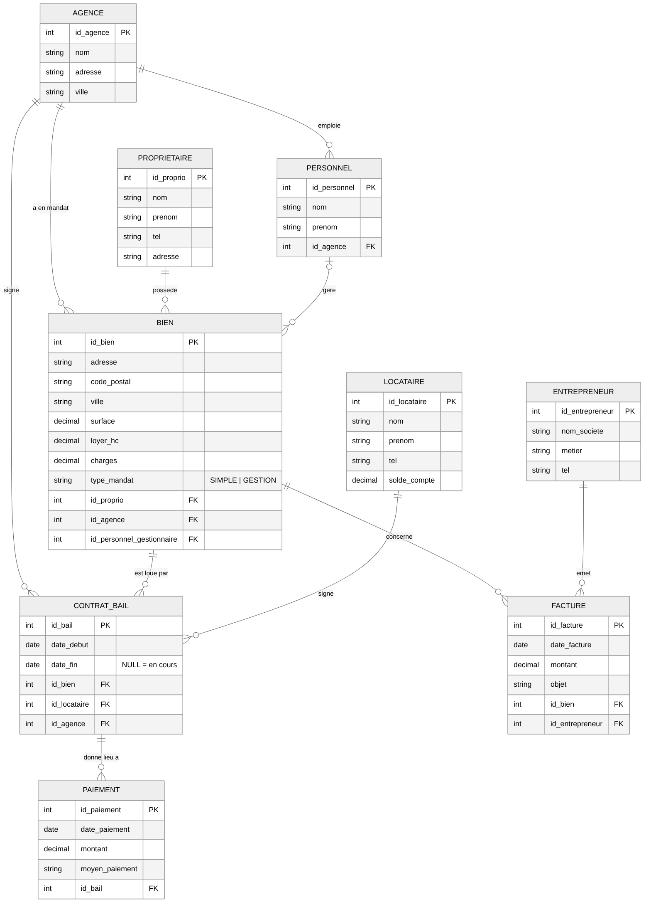

# Real Estate Database

[](https://github.com/SangFuu/real-estate-database/actions/workflows/sql.yml)

Database for a fictional real-estate agency, made with Adnane Serrai during my computer science degree: properties, owners, tenants, leases, rent payments and contractor invoices. All data is fictional.

The project was first built in LibreOffice Base (HSQLDB, with forms and reports). I then rewrote the schema by hand in standard SQL so it runs without LibreOffice, on SQLite or PostgreSQL.



## Run it without LibreOffice

With SQLite:

```sh
sqlite3 agence.db < sql/schema.sql
sqlite3 agence.db < sql/data.sql
sqlite3 -header -column agence.db < sql/queries.sql
```

With PostgreSQL:

```sh
createdb agence
psql -d agence -f sql/schema.sql -f sql/data.sql
psql -d agence -f sql/queries.sql
```

## What the schema enforces

- Named foreign keys between all tables (`fk_bail_bien`, `fk_facture_entrepreneur`...)
- `CHECK` constraints: positive rent, surface and amounts, `date_fin > date_debut` on leases, 5-character postcode, mandate type `SIMPLE` or `GESTION`, known payment methods
- Indexes on foreign keys and on `bien.ville`, which the queries filter on
- `date_fin` is `NULL` while a lease is still running

## Queries

`sql/queries.sql` has the 10 queries from the assignment plus three of mine (tenants in debt, properties without a current lease, rent received minus repair costs per property). For example:

```sql
-- Contractors who worked in Poitiers but never in Châtellerault
SELECT DISTINCT e.nom_societe
FROM entrepreneur e
JOIN facture f ON f.id_entrepreneur = e.id_entrepreneur
JOIN bien b    ON b.id_bien = f.id_bien
WHERE b.ville = 'Poitiers'
  AND NOT EXISTS (
    SELECT 1 FROM facture f2 JOIN bien b2 ON b2.id_bien = f2.id_bien
    WHERE f2.id_entrepreneur = e.id_entrepreneur AND b2.ville = 'Chatellerault'
  );
```

## Files

- `sql/`: portable schema, data and queries
- `docs/mcd.png`: entity-relationship diagram (source in `docs/mcd.mmd`, Mermaid)
- `agence-immobiliere.odb`: the original LibreOffice Base file, with forms and reports (open a copy)
- `hsqldb/`: the schema and queries as exported from LibreOffice (HSQLDB dialect)

## Tests

```sh
python3 -m unittest discover -s tests -v
```

Loads the database in SQLite, checks row counts and foreign keys, checks that invalid rows are rejected by the constraints and checks query results. GitHub Actions also runs the scripts on PostgreSQL 16.

`tests/check.ps1` and `tests/CheckDatabase.java` check the original `.odb` file with HSQLDB.
